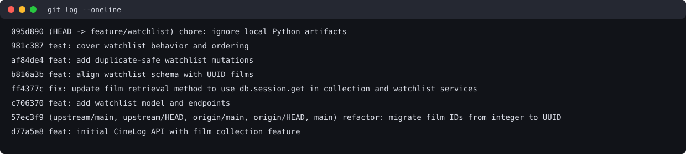

CineLog Project 6 — PR Response
Review Comment Responses
Comment 1: Rename save_to_watchlist()
What I did: Renamed the watchlist service function from save_to_watchlist() to add_to_watchlist() and updated its import and call in routes/watchlist/watchlist.py. This follows the existing add_to_collection() naming convention and makes the two related features easier to understand and maintain.

How I verified: A project-wide search found no remaining Python references to save_to_watchlist(). The latest full test run, pytest tests/ -v, passed all 11 tests before the rebase.
Comment 2: Prevent duplicate watchlist entries
What I did: Added a query in add_to_watchlist() for an existing entry with the same user_id and film_id, after verifying the film exists. If a match exists, the service raises AlreadyInWatchlistError rather than inserting another row. The POST route translates this into HTTP 409. I also added a database unique constraint on (user_id, film_id) as an additional safeguard.

Reasoning: This follows the established add_to_collection() pattern: verify that the film exists, check whether the user already has that film in the relevant list, and raise a dedicated error instead of silently creating a duplicate. The service-level check gives callers a useful error; the database constraint reinforces data integrity.

How I verified: test_add_to_watchlist_duplicate_raises checks that attempting to add the same film twice raises the expected error and leaves one entry. The reported test suite passed.
Comment 3: Watchlist sort order
My position: I chose to display watchlist entries by date_added descending, with the most recently added film first.

Reasoning: CineLog helps people keep track of films they plan to watch. When I save a film, I am likely to return to that recent choice, so showing it near the top helps me find it quickly. This makes the watchlist feel more like a current queue of films I am interested in watching.

Engagement with the reviewer's point and tradeoff: Alphabetical ordering is useful when someone already knows the film title and wants to locate it in a long list. However, it loses the sequence in which films were saved. I prefer newest-first for the default watchlist experience; an alphabetical sort option could be added later for users who want it.

Implementation and verification: get_watchlist() now orders by WatchlistEntry.date_added.desc(). The new test_get_watchlist_returns_newest_first test creates entries with controlled timestamps and confirms the newest title is returned first. Both the focused watchlist tests and full test suite passed before the rebase.
Comment 4: Test a nonexistent film ID
What I did: Added test_add_to_watchlist_nonexistent_film_raises, modeled on the collection service's nonexistent-film test. The service uses db.session.get(Film, film_id) and raises the shared FilmNotFoundError when the UUID is not found, before attempting to insert a watchlist entry.

Reasoning: Missing films should produce a predictable application-level error, not a database integrity failure. Reusing the collection service's error keeps the two features consistent.

How I verified: The new test passed in the reported pytest tests/ -v run. The POST route also catches this error and returns HTTP 404, although a dedicated route test has not been reported.
Comment 5: Default visibility policy
My position: I chose to require an explicit public/private selection when a user adds a film, rather than silently defaulting to public=True.

Reasoning: A watchlist can reflect someone's personal viewing interests, and I want users to understand what they are sharing. The API requires a JSON boolean public field, the service requires that argument, and the model stores it as a non-nullable boolean without a default. Requiring the choice makes the user's intention explicit.

Tradeoff acknowledged: A public default would make adding films quicker and might encourage social discovery, which matters for a community film app. My choice adds one small step but avoids automatically selecting visibility on the user's behalf. I would keep the explicit choice and consider a convenient UI toggle in a future frontend.

Decision about private entries: public=False should mean that other users cannot see the entry. However, the current GET /watchlist/<user_id> route returns both public and private entries and has no authentication or authorization. That means the current implementation does not enforce private access. For a production version, I would return private entries only to their authenticated owner and show other viewers only public entries. Until that access control exists, I would not represent the visibility flag as providing privacy protection. Implementing authenticated access control is outside the verified work in this submission.

How I verified: Service tests verify both public=True and public=False values can be stored. A route-level test verifies that missing and non-boolean public values return HTTP 400 and that both explicit boolean choices return HTTP 201 with the requested value. This does not test or provide authorization for private entries.
Comment 6: Rebase on updated main and use UUID film IDs
What I changed: Updated Film.id, CollectionEntry.film_id, and WatchlistEntry.film_id to db.String(36) columns consistent with the UUID model on updated main. The watchlist service retrieves films by UUID string, and the route accepts film UUIDs in request JSON.

What conflicted: The updated main branch migrated film IDs away from integers while the feature branch still had integer-based model declarations. This creates a type mismatch that must be resolved when integrating the histories.

How I resolved it: Fetched both origin/main and upstream/main; both pointed to 57ec3f9. Created the local backup branch feature-watchlist-backup-20261029 before rebasing. Rebased feature/watchlist onto upstream/main. The first model conflict was resolved by retaining String(36) for WatchlistEntry.film_id and preserving the feature's index. The subsequent schema conflict was an overlapping UUID hunk; I kept main's UUID comment and retained the feature schema constraints. Created feature-watchlist-rebased-backup-20261029 before rewording the inherited feature commit. The branch now includes main and the model has UUID film IDs throughout.

Verification: After the rebase, pytest tests/ -v passed all 11 tests. The merge-commit check for commits after upstream/main returned no commits. The branch history has six conventional commits after main. No push or PR creation has been performed.

Database note: db.create_all() will not migrate an existing database from integer film IDs to UUIDs. Existing databases need a proper migration or a fresh local database; the in-memory tests use the updated schema.
Stretch Features
- Remove from watchlist: Implemented remove_from_watchlist(user_id, film_id) and a DELETE route. Reported tests cover successful removal and NotInWatchlistError for a missing entry.
- Additional edge-case test: The missing-entry removal test verifies that an invalid removal request fails predictably rather than silently succeeding.
- Explicit visibility: The add endpoint requires a boolean public value; service and route tests cover both choices and invalid/missing input. This is visibility metadata, not authorization-enforced privacy.
- Newest-first ordering: get_watchlist() orders by date_added descending. A test verifies that a later entry appears before an earlier one.
Verification
Latest post-rebase commands and results:
pytest tests/ -v
11 passed

git diff --check
No whitespace errors reported
These results include the newest-first sorting and route-level visibility tests and were rerun after the rebase. They do not establish HTTP access-control behavior.
PR Description
Summary
This pull request adds a CineLog watchlist feature for saving, listing, and removing films using UUID film IDs. It prevents duplicate (user_id, film_id) entries, returns clear errors for missing films and duplicates, and requires the caller to explicitly choose a public/private visibility value.
Design decisions
- Visibility: Require an explicit public boolean instead of silently making every new entry public. This field is currently metadata; the GET endpoint does not yet restrict access to private entries.
- Sort order: I chose newest-first by date_added, because recently saved films should be easy to revisit. The implementation and regression test now use date_added descending.
Manual testing
1. Use a fresh database with the UUID schema. Run python seed.py if the repository's seed script is available, then python app.py.
2. Obtain a seeded user UUID and film UUID, for example from the seed output and GET /films/.
3. Send POST /watchlist/<user_id>/add with {"film_id":"<film_uuid>","public":false}. Expect HTTP 201 and public: false in the response.
4. Repeat the POST with the same film. Expect HTTP 409 for a duplicate.
5. POST a nonexistent film UUID. Expect HTTP 404.
6. Add a second film later than the first, then call GET /watchlist/<user_id>. Verify the most recently added entry appears first. Note that the current endpoint returns private entries too.
7. Send DELETE /watchlist/<user_id>/remove with {"film_id":"<film_uuid>"}. Expect HTTP 200. Repeat it and expect HTTP 404.
8. Run pytest tests/ -v after any further changes; the current post-rebase result is 11 passed.
AI Usage
I used GitHub Copilot Agent to inspect the CineLog codebase, assist with the service and route changes, add tests, and draft documentation. I also used ChatGPT to help review the assignment requirements and clarify the tradeoffs behind my design decisions. I chose explicit visibility and newest-first ordering, and reviewed the limitations of the current implementation. I checked the test results against the repository worktree rather than assuming that AI-generated code was correct.
Git Log Screenshot
The image below is a terminal-style rendering of the actual `git log --oneline` output captured after the code history was finalized and before this documentation commit. This container has no desktop display or screenshot utility, so it is not a literal operating-system screen capture. If the assignment requires a native screen capture, replace it with one before submission.

Submission Status
- Working branch: `feature/watchlist`, rebased onto `upstream/main` at `57ec3f9`.
- Local backup refs: `feature-watchlist-backup-20261029` (before rebase) and `feature-watchlist-rebased-backup-20261029` (before commit-message rewrite).
- Six conventional implementation commits are present after main; this response and image will be a separate documentation commit. The merge-commit check was empty.
- The latest post-rebase test run passed all 11 tests; the code has not changed since that run.
- Nothing has been pushed and no PR has been opened. Do not do either without approval.
- A terminal-style history image is embedded; it is not a native screen capture, as noted above.
- Submit the personal fork's branch URL, not the repository root URL.